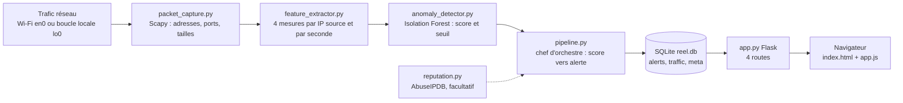
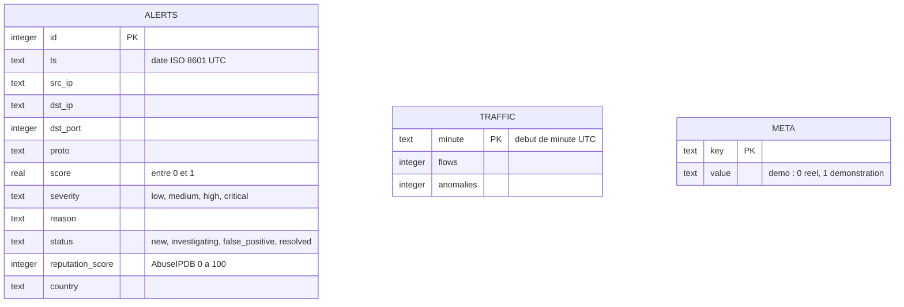
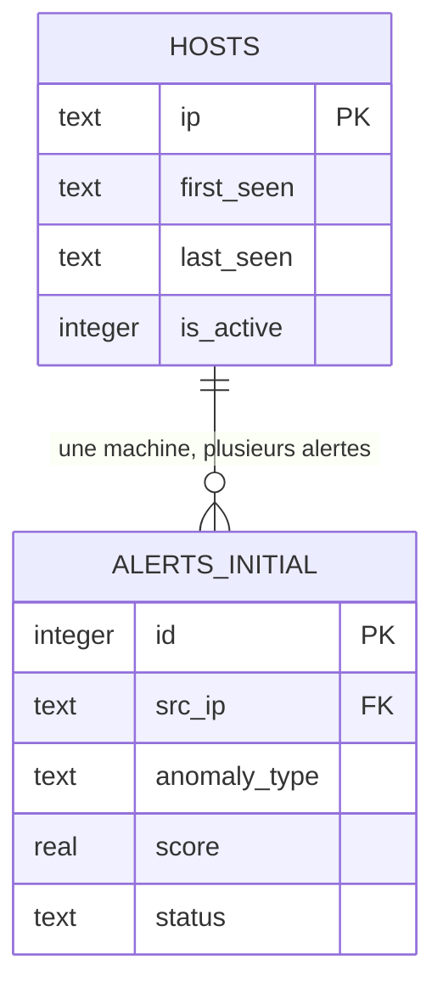

## Architecture

- **Capture** : Scapy lit les adresses, les ports et les tailles, jamais le contenu des paquets.
- **Mesures** : pour chaque IP source et chaque seconde, nombre de paquets, d'octets, de ports distincts et d'IP distinctes.
- **Modèle** : Isolation Forest (non supervisé). Un score négatif sous le seuil déclenche une alerte.
- **Base et API** : le pipeline écrit dans SQLite, l'API Flask lit la base, le navigateur lit l'API toutes les 5 secondes.

## Diagramme de base de données

Les trois tables sont indépendantes (pas de clé étrangère) : l'alerte contient directement l'adresse IP, `traffic` alimente le graphique (une ligne par minute) et `meta` garde des réglages.

Conception initiale (`database.py`, conservée et testée, non utilisée par le pipeline) :

